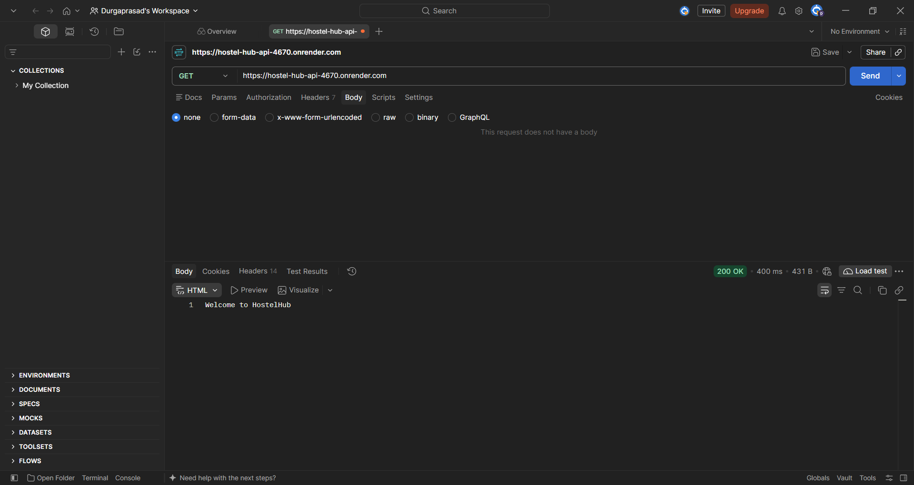
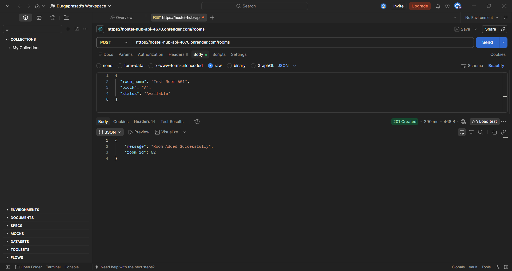
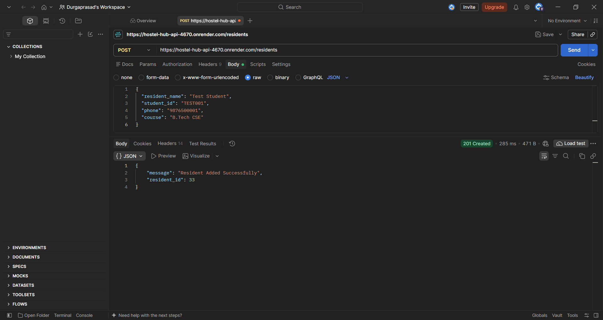

# HostelHub - Room Allotment System

**BDF Group Assignment · Backend Development Fundamentals · Theme 10 · Group YG-AIML2B-G10**

**GitHub:** https://github.com/007Perfect/hostelhub-project

**Deployed link:** https://hostel-hub-api-4670.onrender.com/

## Objective

To build a backend system for the hostel that stores residents, rooms and room allotments in one place, so the warden can quickly see which rooms are free in each block. The project uses an Express server with a SQLite database and provides REST APIs (GET, POST, PUT and DELETE), input validation, search using query parameters, a join endpoint that shows the resident name with the room name, and the rule that no two rooms can have the same name.

## Problem Statement

> "Rooms are allotted from a paper file. The warden cannot quickly tell which rooms are free in each block. Please build us a system that fixes this."

**Our twist: no duplicate names.** Two rooms cannot share a name, even with different capital letters. A duplicate gets `409` and the message `Room 204 already exists`.

### Team Members

| S.No | Name | Registration Number | Contribution |
|---|---|---|---|
| 1 | K GUNEETH | 252U1R6090 | Resident and Room Management |
| 2 | G SAINADH REDDY | 252U1R6076 | SQLite Database Management |
| 3 | J DURGA PRASAD | 252U1R6101 | Room Allotment Management |
| 4 | G ABHISAI | 252U1R6086 | Backend Setup and Server Development |
| 5 | G SRIJAN | 252U1R6093 | Postman Testing and Documentation |

## Run it

Needs [Node.js](https://nodejs.org) 18 or newer.

```bash
npm install     # one time
npm start       # http://localhost:3000
```

The live version is deployed at https://hostel-hub-api-4670.onrender.com/ (on the free plan the first request after a quiet period can take about a minute).

## Database

Three related tables: **residents**, **rooms** and **allotments**. An allotment links one resident to one room.

## API endpoints

Base URL: `https://hostel-hub-api-4670.onrender.com`

| Method | URL | What it does | Success |
|---|---|---|---|
| GET | `/` | Welcome message | 200 |
| GET | `/rooms` | All rooms with `room_id`, `room_name`, `block`, `status` | 200 |
| POST | `/rooms` | Add a room | 201 |
| GET | `/residents` | All residents with `resident_id`, `resident_name`, `student_id`, `phone`, `course` | 200 |
| POST | `/residents` | Add a resident | 201 |
| GET | `/allotments` | All allotments (`allotment_id`, `resident_id`, `room_id`, `allotment_date`) | 200 |
| GET | `/allotments/details` | **Join:** allotments with the resident name and the room name | 200 |
| GET | `/rooms?block=A` | Search rooms by block |

### Search Rooms by Block

HostelHub allows users to search for rooms based on their block name using query parameters.

**Example Request:**

GET `/rooms?block=A`

**Deployed API URL:**

https://hostel-hub-api-4670.onrender.com/rooms?block=A

**Description:**

This endpoint retrieves only the rooms belonging to the specified block. For example, when the user searches for Block A, the API returns all rooms available in Block A.

**Testing:**
- Method: GET
- Parameter: `block`
- Example Value: `A`
- Expected Status: `200 OK`

**Sample request bodies**

Add a room (`POST /rooms`):
```json
{
  "room_name": "Test Room 601",
  "block": "A",
  "status": "Available"
}
```
Response: `201 Created` with `{ "message": "Room Added Successfully", "room_id": 52 }`

Add a resident (`POST /residents`):
```json
{
  "resident_name": "Test Student",
  "student_id": "TEST001",
  "phone": "9876500001",
  "course": "B.Tech CSE"
}
```
Response: `201 Created` with `{ "message": "Resident Added Successfully", "resident_id": 33 }`

Errors are returned as JSON, for example `400 Bad Request` with `{ "error": "Room name and block are required" }` when the room name or block is missing.

## Screenshots

All screenshots are Postman requests to the deployed API.

**GET /** - home



**GET /rooms** - get all rooms (200 OK)


**POST /rooms** - add a room (201 Created)



**GET /residents** - get all residents (200 OK)


**POST /residents** - add a resident (201 Created)



**GET /allotments** - get all allotments (200 OK)


**GET /allotments/details** - join of resident name and room name (200 OK)


**Search Rooms by Block** - Q_Search 


