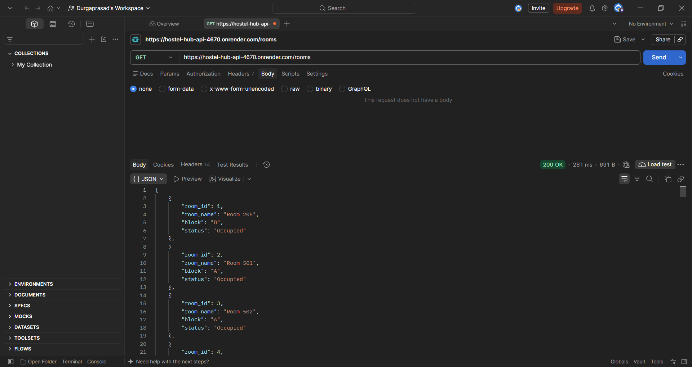
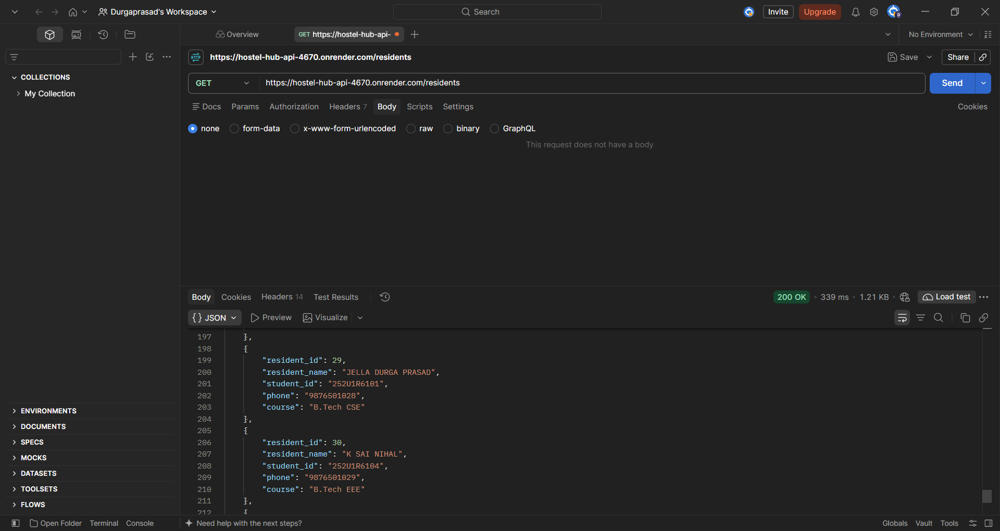
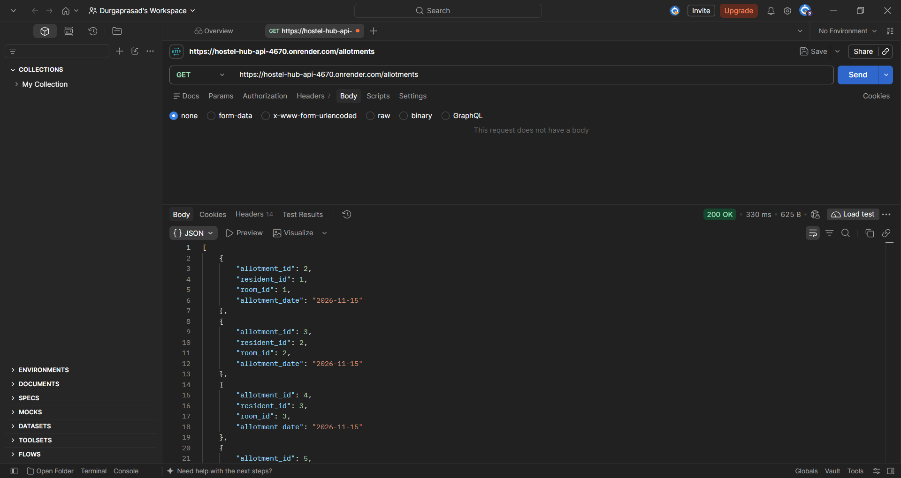
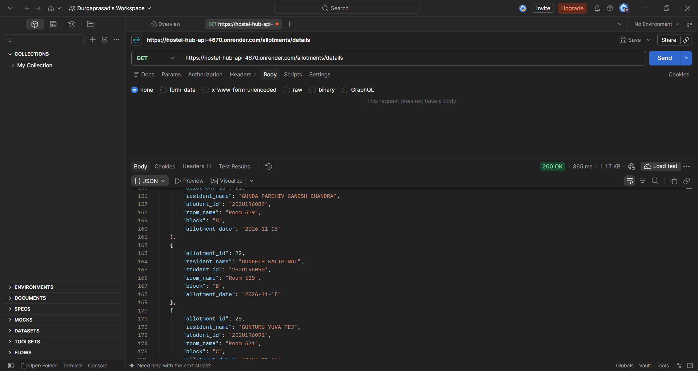
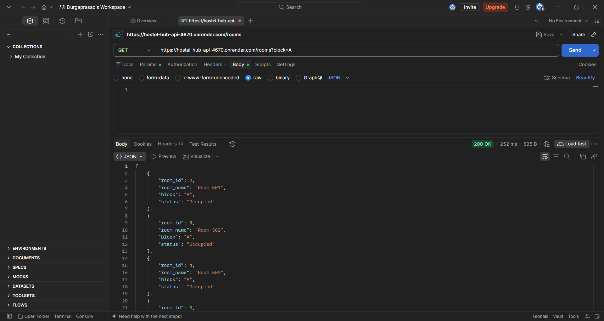

# HostelHub -- Room Allotment Management System

**Course:** Backend Development Fundamentals (BDF)\
**Assignment:** Group Assignment -- Theme 10\
**Group:** YG-AIML2B-G10

**GitHub Repository:** https://github.com/007Perfect/hostelhub-project\
**Live API:** https://hostel-hub-api-4670.onrender.com/

------------------------------------------------------------------------

## 1. Project Overview

HostelHub is a backend application designed to help manage hostel
residents, rooms, and room allotments in one place. It provides REST API
endpoints that allow users to add and view resident information, manage
room records, search rooms by block, and view which resident is assigned
to which room.

The application is built using **Node.js**, **Express.js**, and
**SQLite**. Postman is used to send API requests and test the responses.

The main purpose of this project is to replace manual, paper-based
room-allotment records with a simple and organized digital system.

## 2. Problem Statement

> Rooms are allotted using paper records. The warden cannot quickly
> identify which rooms are available in each block or easily check which
> resident is assigned to a room.

HostelHub addresses this problem by storing resident, room, and
allotment information in a database and making that information
available through REST APIs.

### Key rule: no duplicate room names

A room name must be unique. The system prevents duplicate room names,
including names that differ only in uppercase and lowercase letters.
When a duplicate is submitted, the API returns a `409 Conflict`
response. For example, `Room 204` and `room 204` are treated as
duplicates.

## 3. Project Objectives

-   Store hostel resident information in a structured database.
-   Add and view hostel room details.
-   Keep track of room allotments.
-   Retrieve room information by block using a query parameter.
-   Display allotment information together with resident and room names.
-   Validate incoming data and return meaningful error responses.
-   Provide REST API endpoints that can be tested using Postman.

## 4. Technologies Used

  Technology       Purpose
  ---------------- ---------------------------------------------------------
  Node.js          JavaScript runtime used to run the backend
  Express.js       Framework used to create the server and REST API routes
  SQLite           Database used to store residents, rooms, and allotments
  Postman          Tool used to send API requests and test responses
  Git and GitHub   Version control and project repository
  Render           Platform used to deploy the backend API

## 5. Team Members and Contributions

    S.No. Name              Registration Number   Contribution
  ------- ----------------- --------------------- --------------------------------------
        1 K GUNEETH         252U1R6090            Resident and Room Management
        2 G SAINADH REDDY   252U1R6076            SQLite Database Management
        3 J DURGA PRASAD    252U1R6101            Room Allotment Management
        4 G ABHISAI         252U1R6086            Backend Setup and Server Development
        5 G SRIJAN          252U1R6093            Postman Testing and Documentation

## 6. How the System Works

The application follows a simple backend workflow:

1.  A client (such as Postman) sends an HTTP request to the Express
    server.
2.  Express receives the request and runs the matching API route.
3.  The route reads or changes information in the SQLite database.
4.  The server sends a response, usually in JSON format, with an
    appropriate HTTP status code.

### Main database tables

HostelHub uses three related tables:

  -----------------------------------------------------------------------
  Table                   Purpose                 Main information
  ----------------------- ----------------------- -----------------------
  `residents`             Stores resident details Resident ID, name,
                                                  student ID, phone
                                                  number, and course

  `rooms`                 Stores hostel room      Room ID, room name,
                          details                 block, and status

  `allotments`            Connects residents with Allotment ID, resident
                          rooms                   ID, room ID, and
                                                  allotment date
  -----------------------------------------------------------------------

An allotment record connects a resident to a room using their IDs. The
allotment details endpoint combines information from the related tables
so that the response can show the resident's name and the room's name.

## 7. Installation and Setup

### Requirements

-   Node.js version 18 or newer
-   npm (included with Node.js)
-   A code editor such as Visual Studio Code
-   Postman (for API testing)

### Steps to run the project locally

**Step 1: Open the project folder**

Open the HostelHub project folder in Visual Studio Code or a terminal.

**Step 2: Install dependencies**

``` bash
npm install
```

This command installs the packages listed in `package.json`.

**Step 3: Start the server**

``` bash
npm start
```

**Step 4: Open the API**

When the server starts successfully, use:

``` text
http://localhost:3000/
```

The server uses port `3000` by default. The deployed service can use the
port provided through its environment configuration.

## 8. Deployment

The backend is deployed on Render.

**Live API URL:**

https://hostel-hub-api-4670.onrender.com/

Open the URL in a browser or send a `GET` request in Postman to check
whether the service is responding.

On a free hosting plan, the service may take some time to respond to the
first request after a period of inactivity.

> **Database persistence note:** This project uses a SQLite database
> file. On a hosting service with an ephemeral filesystem, local
> database-file changes may not be permanent across restarts or
> redeployments. For reliable long-term hosted data storage, use a
> persistent disk or migrate the application to a managed database such
> as PostgreSQL.

## 9. API Documentation

### Base URL

For the deployed application:

``` text
https://hostel-hub-api-4670.onrender.com
```

For local testing:

``` text
http://localhost:3000
```

### API endpoint summary

  ----------------------------------------------------------------------------
  Method                  Endpoint                     Description
  ----------------------- ---------------------------- -----------------------
  GET                     `/`                          Returns the welcome
                                                       message and checks the
                                                       server

  GET                     `/residents`                 Retrieves all residents

  POST                    `/residents`                 Adds a new resident

  GET                     `/rooms`                     Retrieves all rooms

  GET                     `/rooms?block=A`             Retrieves rooms
                                                       belonging to Block A

  GET                     `/rooms/:roomId`             Retrieves a room using
                                                       its ID

  POST                    `/rooms`                     Adds a new room

  PUT                     `/rooms/:roomId`             Updates a room using
                                                       its ID

  DELETE                  `/rooms/:roomId`             Deletes a room using
                                                       its ID

  POST                    `/allotments`                Creates a room
                                                       allotment

  GET                     `/allotments`                Retrieves allotment
                                                       records

  GET                     `/allotments/details`        Retrieves allotments
                                                       with resident and room
                                                       details

  DELETE                  `/allotments/:allotmentId`   Cancels an allotment
                                                       using its ID
  ----------------------------------------------------------------------------

Replace `:roomId` and `:allotmentId` with actual IDs. For example,
`/rooms/1` refers to room ID `1`.

### 9.1 Resident APIs

#### Get all residents

-   **Method:** `GET`
-   **Endpoint:** `/residents`
-   **Purpose:** Returns the resident records stored in the database.

#### Add a resident

-   **Method:** `POST`
-   **Endpoint:** `/residents`
-   **Purpose:** Adds a resident to the database.

Select **Body → raw → JSON** in Postman and send:

``` json
{
  "resident_name": "Test Student",
  "student_id": "TEST001",
  "phone": "9876500001",
  "course": "B.Tech CSE"
}
```

A successful request returns `201 Created` and a response containing the
new resident ID.

### 9.2 Room APIs

#### Get all rooms

-   **Method:** `GET`
-   **Endpoint:** `/rooms`
-   **Purpose:** Returns all room records, including their IDs, names,
    blocks, and statuses.

#### Get a room by ID

-   **Method:** `GET`
-   **Endpoint:** `/rooms/1`
-   **Purpose:** Retrieves the room whose ID is `1`. Replace `1` with
    the required room ID.

#### Add a room

-   **Method:** `POST`
-   **Endpoint:** `/rooms`
-   **Purpose:** Adds a room to the database.

Postman body:

``` json
{
  "room_name": "Test Room 601",
  "block": "A",
  "status": "Available"
}
```

A successful request returns `201 Created` and the new room ID.

#### Update a room

-   **Method:** `PUT`
-   **Endpoint:** `/rooms/1`
-   **Purpose:** Updates the details of the room whose ID is `1`.

Example body:

``` json
{
  "room_name": "Test Room 602",
  "block": "B",
  "status": "Available"
}
```

#### Delete a room

-   **Method:** `DELETE`
-   **Endpoint:** `/rooms/1`
-   **Purpose:** Deletes the room whose ID is `1`, subject to the
    project's database and allotment rules.

### 9.3 Allotment APIs

#### Create an allotment

-   **Method:** `POST`
-   **Endpoint:** `/allotments`
-   **Purpose:** Assigns a room to a resident.

Example body:

``` json
{
  "resident_id": 1,
  "room_id": 1,
  "allotment_date": "2026-11-16"
}
```

Use resident and room IDs that actually exist in the database. The room
should be available, and the resident and room must satisfy the
project's allotment rules.

#### Get all allotments

-   **Method:** `GET`
-   **Endpoint:** `/allotments`
-   **Purpose:** Returns the stored allotment records.

#### Get allotment details

-   **Method:** `GET`
-   **Endpoint:** `/allotments/details`
-   **Purpose:** Returns allotment information together with the related
    resident name and room name. This endpoint uses a database join.

#### Cancel an allotment

-   **Method:** `DELETE`
-   **Endpoint:** `/allotments/1`
-   **Purpose:** Cancels the allotment whose ID is `1`. Replace `1` with
    the actual allotment ID.

## 10. Searching Rooms Using Query Parameters

HostelHub supports searching for rooms by block using a query parameter.

**Example:**

``` http
GET /rooms?block=A
```

**Full deployed URL:**

``` text
https://hostel-hub-api-4670.onrender.com/rooms?block=A
```

Here:

-   `?` begins the query-parameter section of the URL.
-   `block` is the parameter name.
-   `A` is the parameter value.

To search another block, change the value. For example:

``` text
https://hostel-hub-api-4670.onrender.com/rooms?block=B
```

The API returns the rooms that match the supplied block.

## 11. Testing with Postman

Postman is used to test the API without needing a frontend application.

### General testing steps

1.  Open Postman.
2.  Create a new HTTP request.
3.  Select the required method: `GET`, `POST`, `PUT`, or `DELETE`.
4.  Enter the local or deployed API URL.
5.  For `POST` and `PUT`, open **Body → raw → JSON** and enter the
    request data.
6.  Click **Send**.
7.  Check the response body and HTTP status code.

### Recommended testing order

1.  Send `GET /` to check the server.
2.  Send `POST /residents` to create a resident.
3.  Send `GET /residents` to verify the resident.
4.  Send `POST /rooms` to create a room.
5.  Send `GET /rooms` to verify the room.
6.  Send `GET /rooms?block=A` to test block-based searching.
7.  Use the returned resident and room IDs to send `POST /allotments`.
8.  Send `GET /allotments` and `GET /allotments/details` to verify the
    allotment.
9.  Test update and delete operations using valid record IDs.

### Common HTTP status codes

  -----------------------------------------------------------------------
  Status code                         Meaning
  ----------------------------------- -----------------------------------
  `200 OK`                            The request completed successfully

  `201 Created`                       A new record was created
                                      successfully

  `400 Bad Request`                   Required input is missing or
                                      invalid

  `404 Not Found`                     The requested record or route was
                                      not found

  `409 Conflict`                      The request conflicts with an
                                      existing record, such as a
                                      duplicate room name

  `500 Internal Server Error`         An unexpected server-side error
                                      occurred
  -----------------------------------------------------------------------

Error responses are returned in JSON format. For example, a room request
with missing required fields may return:

``` json
{
  "error": "Room name and block are required"
}
```

## 12. Screenshots

The following screenshots show Postman requests and responses from the
deployed API. The image paths are relative to this README file.

### Check the server


### Retrieve all rooms



### Add a room


### Retrieve all residents



### Add a resident


### Retrieve all allotments



### Retrieve allotment details using a join



### Search rooms by block



## 13. Project Benefits

-   Keeps resident, room, and allotment information organized.
-   Makes it easier to retrieve room details.
-   Helps identify rooms by block.
-   Provides a combined view of allotments, resident names, and room
    names.
-   Reduces dependence on paper-based records.
-   Allows the backend to be tested through standard HTTP requests.

## 14. Current Scope and Future Improvements

The current project focuses on backend APIs for residents, rooms, and
allotments. It does not include a web-based frontend or a warden
dashboard.

Possible future improvements include:

-   Creating a frontend dashboard for wardens.
-   Adding login and role-based access for wardens and administrators.
-   Adding pagination and more search filters.
-   Improving database deployment with persistent storage or a managed
    database.
-   Adding reports for available rooms, occupied rooms, and allotment
    history.
-   Adding stronger validation and automated API tests.

## 15. Conclusion

HostelHub provides a simple backend solution for managing hostel
residents, rooms, and room allotments. By storing information in a
SQLite database and making it accessible through Express.js REST APIs,
the project demonstrates how a manual room-allotment process can be
organized into a digital system.

The project also gives practical experience with Node.js, Express.js,
database operations, HTTP methods, query parameters, SQL joins, Postman
testing, GitHub version control, and deployment using Render.

Overall, HostelHub meets its core objective of making hostel room
information easier to store, retrieve, and manage. It also provides a
foundation for future development, such as a warden dashboard, user
authentication, and more advanced reporting features.
